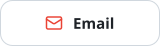
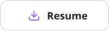
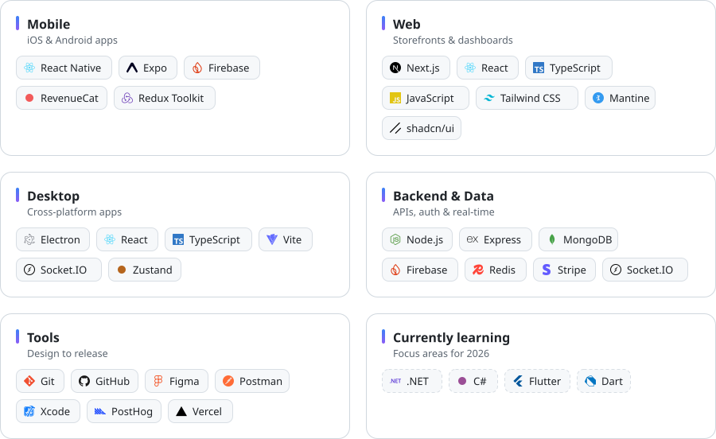
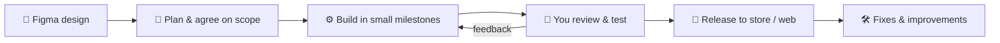

<!-- Animated header -->
<p align="center">
  
</p>

<!-- Typing headline -->
<p align="center">
  <a href="https://ayubislam1.vercel.app">
    
  </a>
</p>

<!-- Quick links -->
<p align="center">
  <a href="https://ayubislam1.vercel.app"></a>
  <a href="https://www.linkedin.com/in/ayub-islam-749284299/"><picture>
    <source media="(prefers-color-scheme: dark)" srcset="./assets/btn-linkedin-dark.svg" />
    
  </picture></a>
  <a href="mailto:ayubislam863@gmail.com"><picture>
    <source media="(prefers-color-scheme: dark)" srcset="./assets/btn-email-dark.svg" />
    
  </picture></a>
  <a href="https://ayubislam1.vercel.app/Resume.pdf"><picture>
    <source media="(prefers-color-scheme: dark)" srcset="./assets/btn-resume-dark.svg" />
    
  </picture></a>
</p>

<p align="center">
  <picture>
    <source media="(prefers-color-scheme: dark)" srcset="./assets/status-dark.svg" />
    
  </picture>
</p>

---

## 👨‍💻 About me

```ts
const ayub = {
  role: "Junior Software Developer @ a small product team",
  location: "Chattogram, Bangladesh 🇧🇩",
  builds: ["📱 mobile", "🌐 web", "🖥️ desktop"],
  shipped: {
    appStore: ["NoteGenie AI", "Daily Gratitude"],
    desktop: "NeuroLauncher (Electron)",
    web: ["Gift Cards Zone BD (Next.js, live store)", "Device Management System (full-stack)"],
  },
  workflow: "Figma → small milestones → review → release",
  learning: ["System design", ".NET architecture", "Redis", "Flutter"],
  education: "B.Sc. in CSE, Port City International University",
  openTo: "full-time roles",
};
```

---

## 🧰 Tech stack

<p align="center">
  <picture>
    <source media="(prefers-color-scheme: dark)" srcset="./assets/stack-dark.svg" />
    
  </picture>
</p>

---

## 🚀 Featured work

| Project | What it is | Stack | Links |
| --- | --- | --- | --- |
| 📱 **NoteGenie AI** | AI note taker for students: lectures, PDFs and YouTube links become notes, flashcards and quizzes. | React Native · Expo · Firebase · RevenueCat | [App Store](https://apps.apple.com/us/app/lecture-note-taker-note-genie/id6748276655) |
| 📱 **Daily Gratitude** | Gratitude journal with voice and photo entries, affirmations and daily streaks. | React Native · Expo · Redux Toolkit · Firebase | [App Store](https://apps.apple.com/us/app/daily-gratitude-planner/id6758459541) |
| 🖥️ **NeuroLauncher** | Desktop launcher that installs, licenses and opens a client's games and tools, with an admin panel. | Electron · React · TypeScript · Socket.IO | 🔒 Private (client) |
| 🛒 **Gift Cards Zone BD** | Live store for gift cards, game keys and mobile recharge, with orders, reviews and a customer dashboard. | Next.js · Mantine · Redux Toolkit | [Live](https://giftcardszonebd.com) |
| 🗄️ **Device Management System** | Client's device management platform with document, export and warehouse features, plus a support portal with ticketing, live chat and an AI assistant. | Next.js · Node.js · Express · MongoDB | 🔒 Private (client) |
| 🛍️ **ShopSphere** | Multi-vendor e-commerce platform with Stripe checkout, vendor dashboards, real-time buyer–vendor chat and an admin panel. Team project. | Next.js · MongoDB · NextAuth · Socket.IO · Stripe | [🌐 Live](https://shops-sphere.vercel.app/) |
| 💻 **Gadget Heaven** | Gadget store for laptops, phones, headphones and watches, with a persistent cart, price sorting, wishlist and checkout flow. | React · React Router · Tailwind CSS · Recharts | [🌐 Live](https://gadget1.netlify.app/) |

<details>
<summary><b>🔍 What I actually did on each product</b> (click to expand)</summary>
<br />

- **NoteGenie AI**: delivered the app's redesign from Figma across onboarding, paywall/subscription and the core study screens; added multi-language support; supported iOS and Android releases.
- **Daily Gratitude**: delivered the visual refresh of the journaling experience, theming and dark mode, screen transition animations, Google and Apple account linking, and profile photo upload.
- **NeuroLauncher**: primary developer. Built the launcher and its admin panel: catalogue UI, download management with offline caching, licensing and sign-in, and real-time local services with Express and Socket.IO.
- **Gift Cards Zone BD**: primary developer of the storefront: catalogue, product and deals pages, orders, reviews, customer dashboard, REST API and auth integration, and image/performance optimisation.
- **Device Management System**: full-stack work across the web app and its API: document, export and warehouse features, plus a support portal with ticketing, live chat and an AI assistant.

</details>

<p align="right"><a href="https://ayubislam1.vercel.app">See all projects on my portfolio →</a></p>

---

## 🔁 How I ship



---

## 📊 GitHub activity

<p align="center">
  <picture>
    <source media="(prefers-color-scheme: dark)" srcset="https://raw.githubusercontent.com/ayubislam1/ayubislam1/output/profile-night-rainbow.svg" />
    
  </picture>
</p>

<p align="center">
  <picture>
    <source media="(prefers-color-scheme: dark)" srcset="https://streak-stats.demolab.com?user=ayubislam1&theme=tokyonight&hide_border=true&background=0D1117" />
    
  </picture>
</p>

<p align="center">
  
</p>

---

<p align="center">
  <b>Have a product to build?</b> Let's talk: <a href="mailto:ayubislam863@gmail.com">ayubislam863@gmail.com</a> 🤝
</p>

<p align="center">
  
</p>
